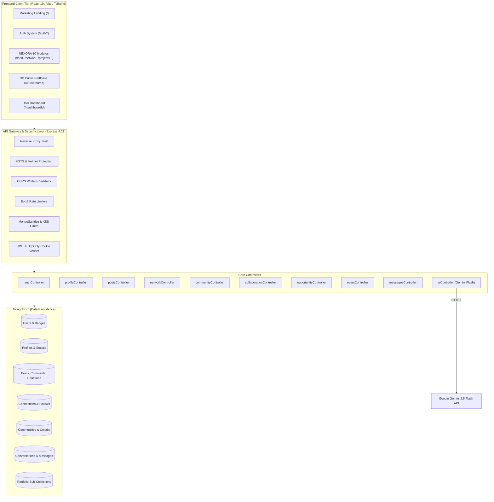
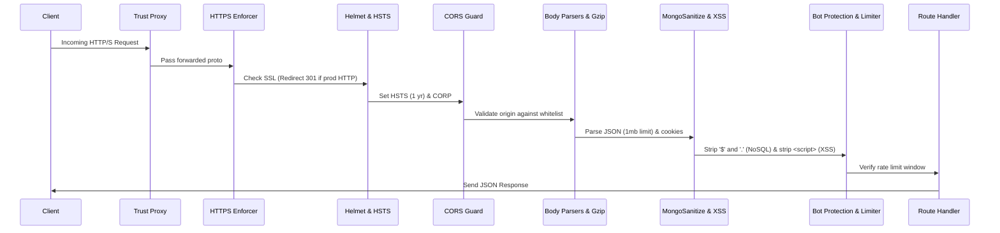
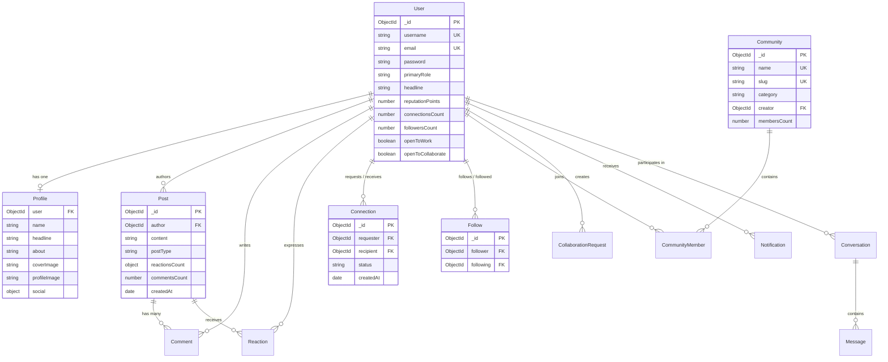

# NEXORA: Existing System Architecture & Database Design

> **Document Version:** 1.0.0  
> **Target System:** NEXORA – The Network for Builders  
> **Status:** Current State Architectural Baseline

---

## 1. High-Level System Architecture

NEXORA operates as a decoupled full-stack platform consisting of a React client, an Express.js API Gateway, MongoDB persistence, and an external server-side Google Gemini 2.5 Flash AI integration.

---

## 2. Frontend Architecture

### State & Context Architecture
The frontend state is managed via React Context without external heavy state stores:
1. **`AuthContext.jsx`**:
   - Manages active user session (`user`, `isAuth`, `loading`).
   - Stores access token exclusively in memory (`setAccessToken`) to eliminate XSS token theft.
   - Restores session automatically via silent refresh (`authAPI.refresh()`) querying the HttpOnly cookie.
2. **`ThemeContext.jsx`**:
   - Controls Dark/Light theme toggle and system preference detection.
   - Persists user preference in `localStorage.getItem('theme')`.
3. **`BackgroundContext.jsx`**:
   - Manages interactive 3D background canvases for standalone portfolios (`ParticleBackground`, `CyberGridBackground`, `MinimalMesh`).

### Routing Precedence & Resolution (`App.jsx`)
React Router 6 parses incoming paths in strict order:
1. Static marketing & policy routes (`/`, `/terms`, `/privacy`).
2. Authentication routes (`/auth/*`).
3. **NEXORA AppLayout routes**: `/feed`, `/network`, `/discover`, `/communities`, `/projects`, `/opportunities`, `/events`, `/messages`, `/notifications`, `/profile/me`, `/profile/:username`.
4. **Public 3D Portfolios**: `/u/:username` handled by `PortfolioLayout.jsx`.
5. **Admin Dashboard / CMS**: `/:dashboardId` protected by `ProtectedRoute.jsx`.
6. Root fallback: `<NotFound />`.

### Responsive Layout Framework (`AppLayout.jsx`)
- **Desktop (>= 1024px):** 3-column layout featuring a sticky Left Navigation Rail, Top Header with live unread indicators, Main Content Stream, and Right Insight Sidebar.
- **Mobile (< 768px):** Sticky Top Header with compact brand logo + fixed Bottom Navigation Bar providing one-touch access to Feed, Network, Communities, Projects, and Notifications.

---

## 3. Backend Architecture

### Middleware Execution Pipeline
Every request to the backend passes through the following middleware sequence:

---

## 4. Database Architecture & Schema Relationships

### Entity Relationship Diagram

### Key Compound Indexes Defined
- **Connection:** `{ requester: 1, recipient: 1 }` (unique constraint across peers).
- **Follow:** `{ follower: 1, following: 1 }` (unique constraint preventing duplicate follows).
- **Reaction:** `{ user: 1, targetId: 1 }` (unique constraint preventing multiple reactions on the same post).
- **CommunityMember:** `{ community: 1, user: 1 }` (unique constraint preventing double memberships).
- **Post:** `{ author: 1, createdAt: -1 }`, `{ hashtags: 1 }`, `{ postType: 1, createdAt: -1 }`.
- **Conversation:** `{ participants: 1, updatedAt: -1 }`.

---

## 5. Authentication & Authorization Architecture

### Dual-Token Security Model
- **Access Token:**
  - Standard JWT with short TTL (15 minutes).
  - Stored strictly in frontend JavaScript memory (`api.js` module closure).
  - Sent via standard `Authorization: Bearer <token>` header.
- **Refresh Token:**
  - Long TTL (7 days default, 30 days if "remember me" checked).
  - Stored in an `HttpOnly`, `SameSite=Strict`, `Path=/api/auth` cookie.
  - Automatically verified upon 401 response via silent background refresh.

### Password Security & Lockout
- Passwords hashed using `bcryptjs` with salt round cost factor 12.
- Brute-force protection: Accounts lock automatically for 15 minutes after 5 consecutive failed login attempts (`lockout.js`).
- OTP codes (for email verification and password resets) are salted with an environment `OTP_PEPPER` before cryptographic hashing and storage.

---

## 6. Deployment Architecture

### Docker Multi-Container Compose Configuration
- **`mongo` Service:** Official MongoDB 7 container with persistent volume `mongo_data`.
- **`backend` Service:** Node.js alpine container running Express on port 5000, mapped to `uploads` volume for media storage.
- **`frontend` Service:** Multi-stage Docker build utilizing Vite build step, served via Nginx on port 80/8080 with reverse-proxy rules routing `/api` traffic directly to the backend container.

### Cloud Environments
- **Frontend (Vercel):** Single-page application rewrites defined in `frontend/vercel.json` routing all `/(.*)` requests to `/index.html`.
- **Backend (Render / Railway / Cloud Run):** Production Express instance with `NODE_ENV=production` and SSL enforcement.
