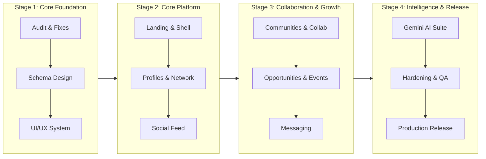

# NEXORA: Transformation & Migration Master Plan

> **Document Version:** 1.0.0  
> **Target System:** NEXORA – The Network for Builders  
> **Status:** Strategic Roadmap & Implementation Blueprint

---

## 1. Executive Migration Strategy

The migration from **Portfolio Publisher** to **NEXORA** is designed on a principle of **zero-downtime, non-destructive additive evolution**:
- **Existing User Data:** 100% preserved. No collections are dropped; existing portfolio records remain completely intact.
- **Standalone 3D Portfolios:** The legacy core functionality (`/u/:username` and `/:dashboardId`) remains fully operational alongside the new social, community, collaboration, and messaging hubs.
- **Rollback Safety:** All new tables and fields are decoupled and backward-compatible.

---

## 2. Prioritized Implementation Roadmap

The transformation is structured into 4 sequential stages, divided across 12 milestones:



### Stage 1: Core Foundation (Milestones 1 – 3)
- **Milestone 1: Repository Audit & Bug Fixes (Priority: High)**
  - Audit all 145 files. Fix database sort order bugs in `profileController.js`.
  - Fix reserved route collisions (`/u/:username` vs root parameters).
- **Milestone 2: Schema Architecture & Database Extensions (Priority: High)**
  - Extend `User` and `Profile` models with builder attributes (reputation, roles, badges).
  - Provision 13 new modular schemas (`Post`, `Comment`, `Reaction`, `Connection`, `Follow`, `Community`, `CommunityMember`, `CollaborationRequest`, `Opportunity`, `Event`, `Conversation`, `Message`, `Notification`).
- **Milestone 3: UI/UX Design System & Tokens (Priority: Medium)**
  - Standardize 10 theme palettes, typography scale, responsive containers, desktop 3-column rail, and mobile bottom navigation bar.

### Stage 2: Core Platform (Milestones 4 – 6)
- **Milestone 4: Marketing Landing & App Shell (Priority: High)**
  - Redesign landing page navbar, hero, features, and footer sections.
  - Implement `AppLayout.jsx` with persistent navigation for the 10 core hubs.
- **Milestone 5: Professional Profiles & Networking (Priority: High)**
  - Implement bidirectional connection requests, auto-accept logic, and unidirectional follow graph.
  - Deliver dynamic Builder Profiles (`/profile/me` and `/profile/:username`) with cover image upload, skills proof, and direct links to 3D portfolios.
  - Deliver Discover directory with debounced builder and skill search.
- **Milestone 6: Social Feed, Posts, Comments & Reactions (Priority: High)**
  - Implement feed pagination, build-in-public devlogs, milestone announcements, and code snippet embeds.
  - Multi-reactions engine (`like`, `celebrate`, `insightful`, `love`).
  - Threaded comment system.

### Stage 3: Collaboration & Growth (Milestones 7 – 9)
- **Milestone 7: Communities & Project Collaboration (Priority: High)**
  - Deliver Technical Communities (guild creation, category filtering, member tracking).
  - Deliver "Find My Teammate" Project Hub (collaboration calls, role definitions, teammate pitches, applicant acceptance).
- **Milestone 8: Opportunities, Events & Notifications (Priority: Medium)**
  - Deliver Opportunities Radar (internships, fresher jobs, freelance contracts, save bookmarks, quick apply).
  - Deliver Hackathons & Events (schedule webinars, RSVP tracking).
  - Deliver Notifications Engine (real-time alerts for connections, reactions, comments, and applications).
- **Milestone 9: Real-Time Direct Messaging (Priority: High)**
  - Deliver direct conversation threads, message history, read receipts, and profile integrations.

### Stage 4: Intelligence & Release (Milestones 10 – 12)
- **Milestone 10: Gemini AI Server-Side Suite (Priority: High)**
  - Implement secure server-side integration with `gemini-2.5-flash`:
    - Executive recruiter profile summary.
    - Post-writing assistant & devlog polisher.
    - Technical project description generator.
    - 4-phase technical career roadmap.
- **Milestone 11: Security, Performance & QA Hardening (Priority: Critical)**
  - Perform AST and syntax checks across all files.
  - Verify HSTS, Helmet, NoSQL injection filtering, XSS protection, and rate limiting.
- **Milestone 12: Production Deployment & Docker Packaging (Priority: High)**
  - Finalize `docker-compose.yml`, environment configurations, and Vercel SPA rewrites.

---

## 3. Backwards Compatibility & Data Preservation Guarantee

```
Legacy Portfolio Publisher                NEXORA Platform Ecosystem
┌──────────────────────────┐             ┌───────────────────────────────────┐
│ User Account (email/pwd) │  ─────────> │ User Account + Builder Reputation │
├──────────────────────────┤             ├───────────────────────────────────┤
│ Profile (name/about)     │  ─────────> │ Profile + Cover Image + Badges    │
├──────────────────────────┤             ├───────────────────────────────────┤
│ /u/:username             │  ─────────> │ /u/:username (Preserved 100%)     │
├──────────────────────────┤             ├───────────────────────────────────┤
│ /:dashboardId            │  ─────────> │ /:dashboardId (Preserved 100%)    │
└──────────────────────────┘             ├───────────────────────────────────┤
                                         │ NEW: Social Feed (/feed)          │
                                         │ NEW: My Network (/network)        │
                                         │ NEW: Communities (/communities)   │
                                         │ NEW: Collab Board (/projects)     │
                                         │ NEW: Opportunities (/opportunities│
                                         │ NEW: Direct Messaging (/messages) │
                                         │ NEW: Gemini AI Suite (/api/ai)    │
                                         └───────────────────────────────────┘
```

1. **Zero Data Destruction:** Existing user records, login credentials, portfolio links, QR codes, and custom theme settings are never deleted or modified destructively.
2. **Dual-Route Coexistence:** Standalone 3D portfolios remain accessible at `/u/:username` for sharing with recruiters and on resumes, while logged-in builders access the full collaborative ecosystem on `/feed`, `/network`, and `/profile/me`.

---

## 4. Rollback & Disaster Recovery Strategy

| Scenario | Rollback Procedure | Data Impact |
|---|---|---|
| **MongoDB Schema Conflict** | Additive schemas can be safely left or deleted without affecting legacy `User` or `Profile` core fields. | Zero impact on legacy user profiles. |
| **API Gateway Failure** | Revert `server.js` route mounts to legacy routes only (`auth`, `profile`, `portfolio`, `crud`). | New features temporarily dormant; legacy portfolio sharing remains 100% functional. |
| **Frontend Routing Failure** | Revert `App.jsx` route tree to legacy fallback routes. | Standalone `/u/:username` portfolios remain accessible. |

---

## 5. Verification & Acceptance Criteria

Each milestone is considered accepted only when meeting the following criteria:
1. **Automated Syntax & Bracket Integrity:** 100% of `.js` and `.jsx` files pass AST bracket balance check.
2. **Access Control:** All mutating endpoints require valid Bearer JWT and verify resource ownership.
3. **Responsive Verification:** Tested and responsive across Desktop (1280px+), Tablet (768px–1024px), and Mobile (375px–767px).
4. **Graceful Fallback:** If external APIs (Gemini, SMTP) are unreachable, the UI provides clean fallback states without application crashes.
